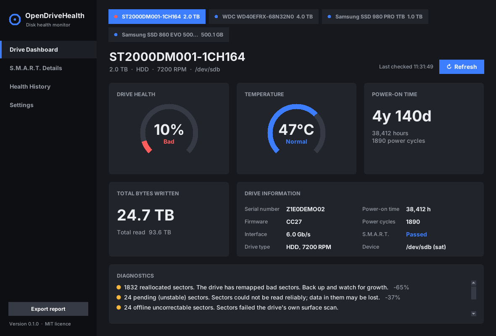
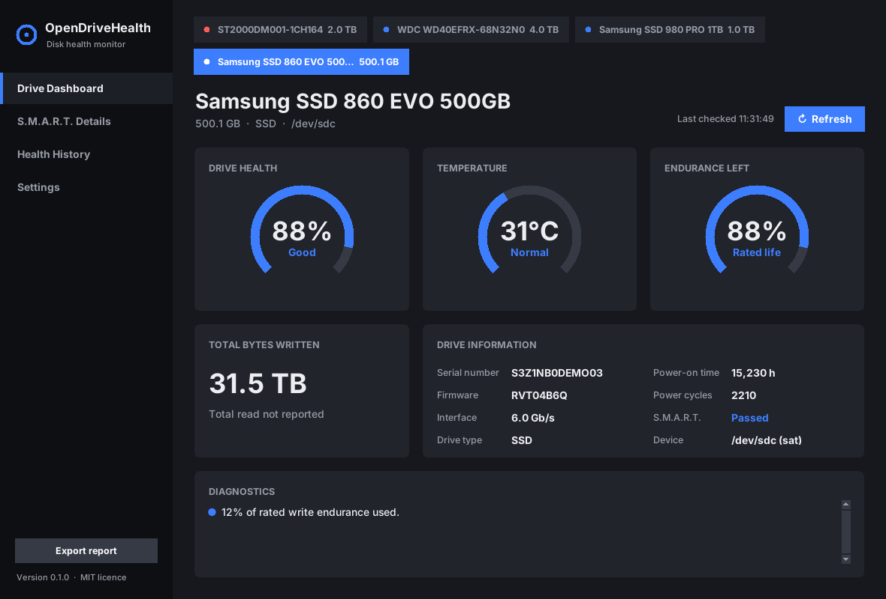
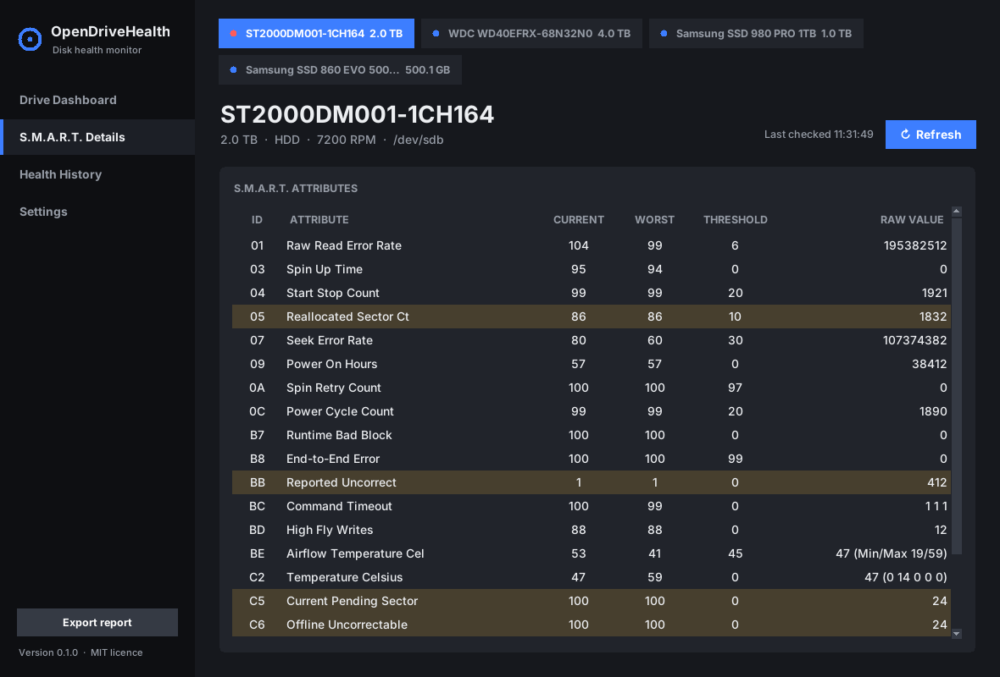
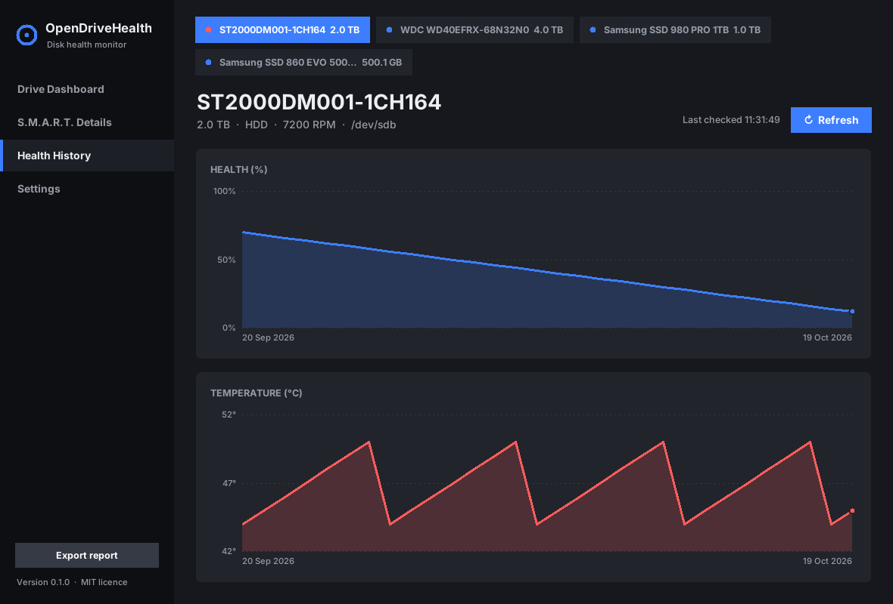

# OpenDriveHealth

**Free, open-source hard drive and SSD health monitor.** It combines the
at-a-glance S.M.A.R.T. view of *CrystalDiskInfo* with the health percentage,
plain-English explanations and history tracking of *HDD Sentinel*, and runs on
Windows, Linux and macOS.



## Features

- **Every common drive type**: SATA/SAS HDDs, SATA SSDs, NVMe, and most USB
  enclosures, through [smartmontools](https://www.smartmontools.org).
- **Status at a glance**: Good / Caution / Bad, using CrystalDiskInfo's rules.
- **Health percentage**, HDD Sentinel style. Every point deducted is explained
  on the *Findings* tab, so nothing is a black box.
- **SSD endurance**: how much of the rated write life is left, plus total host
  reads and writes.
- **Full attribute table**, with problem attributes highlighted. NVMe health
  logs are shown in the same table format.
- **History and alerts**: each check is saved to a local SQLite database.
  You're alerted when *anything gets worse*, such as a new bad sector, a
  status change, a health drop or overheating. A growing defect count is the
  best early warning of failure.
- **Modern dark dashboard**: ring gauges for health, temperature and SSD
  endurance, total bytes written, and a diagnostics list, with sidebar pages
  for the S.M.A.R.T. table, history charts and settings.
- **Charts** of health and temperature over time.
- **Doesn't wake sleeping disks** by default.
- **Scriptable CLI** with JSON output and Nagios-style exit codes for servers
  and NAS boxes.
- **No dependencies beyond Python and smartmontools.** The GUI uses Tkinter,
  which ships with Python.

| SSD | S.M.A.R.T. details | History |
|---|---|---|
|  |  |  |

## Install

1. Install **smartmontools** (7.0 or newer):
   - Windows: the installer from <https://www.smartmontools.org/wiki/Download>
     (or `winget install smartmontools.smartmontools`)
   - Debian/Ubuntu: `sudo apt install smartmontools`
   - Fedora: `sudo dnf install smartmontools`
   - macOS: `brew install smartmontools`
2. Install OpenDriveHealth (Python 3.9+):

   ```sh
   pip install .          # from this folder
   ```

Reading S.M.A.R.T. data needs elevated rights. Run from an **Administrator**
prompt on Windows, or with `sudo` on Linux/macOS.

## Use

### Desktop app

```sh
odh-gui              # real drives (run elevated)
odh-gui --demo       # try it with built-in sample drives
```

Press **F5** or **Refresh** to re-check. Set the background check interval,
history recording and whether to wake sleeping drives on the **Settings**
page. **Export report** (bottom left) saves JSON or text.

### Command line

```sh
odh                    # summary table of all drives
odh show               # full details for every drive
odh show sda           # one drive (index, device path or serial)
odh show 0 --json      # machine-readable
odh check              # save a snapshot and print alerts
odh check -q --notify  # alerts only, plus a desktop notification
odh monitor --interval 600
odh history            # drives with recorded history
odh history WD40EFRX   # trend table for one drive
odh --demo             # sample data, no hardware needed
odh --json-file dump.json   # analyse a saved `smartctl -a --json` dump
```

`odh check` exits with **0** (Good), **1** (Caution), **2** (Bad) or
**3** (Unknown), so you can drop it into Nagios, Icinga, Zabbix, cron or Task
Scheduler as is.

Run it on a schedule:

```sh
# Linux, /etc/cron.d/opendrivehealth: check hourly, mail on alerts
0 * * * * root odh check -q
```

```powershell
# Windows: check hourly as SYSTEM
schtasks /Create /TN OpenDriveHealth /SC HOURLY /RU SYSTEM /TR "odh check -q"
```

History is stored in `%APPDATA%\OpenDriveHealth` (Windows),
`~/Library/Application Support/OpenDriveHealth` (macOS) or
`~/.local/share/opendrivehealth` (Linux). Override the location with `--db`
or `ODH_DB`. If smartctl isn't on your `PATH`, set `ODH_SMARTCTL`.

## How health is calculated

**Status** follows CrystalDiskInfo's rules:

| Status | When |
|---|---|
| Bad | The drive's own S.M.A.R.T. self-assessment fails, an attribute is at or below its vendor threshold, an NVMe critical warning reports spare/reliability/read-only problems, or health falls below 25% |
| Caution | Any reallocated (05), pending (C5) or uncorrectable (C6) sectors, reported uncorrectable errors (BB), spin retries (0A), NVMe media errors, less than 10% SSD endurance left, or health below 60% |
| Good | None of the above |

**Health %** starts at 100. Each problem removes a share of what's left, and
the size of each deduction grows with the logarithm of the count. The first
bad sector costs the most, and several problems together push the score
towards 0. For SSDs the result is then scaled by the remaining rated
endurance. The weights are in
[`health.py`](src/opendrivehealth/health.py) (`WEIGHTS`). They're deliberately
easy to read and tune, and pull requests with real-world failure data are very
welcome.

Interface CRC errors (C7) are reported but don't lower the score. They almost
always point to a bad cable, not a failing drive.

> No tool can predict every failure. S.M.A.R.T. misses many sudden
> electronic or firmware failures. **Keep backups.**

## Project layout

```
src/opendrivehealth/
  smartctl.py   backend: runs smartctl --json and parses it
  health.py     status + health % engine
  history.py    SQLite snapshots and change alerts
  cli.py        `odh` command
  gui.py        `odh-gui` Tkinter desktop app
  widgets.py    dark theme, cards, ring gauges, toggles and charts
  demo/         sample smartctl dumps (also used by the tests)
tests/          pytest suite
```

## Development

```sh
pip install -e .[test]
pytest
```

You can help without coding by contributing anonymised dumps from drives with
problems: `smartctl -a --json /dev/sdX > drive.json`, with the serial number
removed. They become test cases and improve the scoring.

## Roadmap

- Standalone Windows `.exe` (PyInstaller) and Linux AppImage / Flatpak
- System tray icon with the temperature, plus a Windows service mode
- Email / webhook alerts
- Running drive self-tests (short/long) from the GUI
- Read/write surface scan and benchmark
- Vendor-specific SSD attribute names and endurance (TBW) ratings
- Translations

## License

MIT, see [LICENSE](LICENSE). OpenDriveHealth isn't affiliated with
CrystalDiskInfo or HDD Sentinel.
